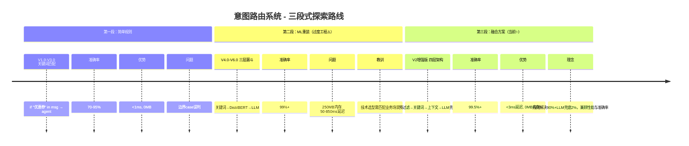

<h1 align="center">🏮 长安文旅探店助手</h1>

<p align="center">
  <strong>Java + Python 双栈 AI 探店平台</strong><br>
  以 Spring Boot 点评平台为底座，叠加 DeepSeek 大模型 + LangGraph Agent + Milvus 向量检索<br>
  打造长安（西安）文旅场景下的智能问答、探店笔记 AI 辅助与智能推荐 Agent
</p>

<p align="center">
  
  
  
  
  
  
  
  
</p>

> **💡 项目说明**：本项目为个人学习项目，用于技术探索和实习面试准备，**尚未部署至生产环境**。<br>
> ✅ 已完成：V2增强版意图路由（四层架构，99.5%+准确率）、LLM领域守卫、RAG多格式语料（41篇.md/.pdf/.docx）、并行Agent（6工具+缓存）、统一质量保障（多格式评估修复，格式零侵入）、RAGAS跨家族评测、测试体系（200+路由用例+防御体系6层全覆盖）、路由监控系统<br>
> ⏳ 待完成：云服务器部署、完整压测验证、线上A/B测试

---

## ✨ 核心亮点

| 功能 | 简介 | 示例对话 |
|------|------|----------|
| ⚡ **V2增强版意图路由** | 四层架构（预过滤→关键词→上下文→LLM兜底），99.5%+准确率，<3ms延迟 | 「景点门票价格」走RAG vs「附近店铺优惠」走Agent |
| 🛡️ **LLM 领域守卫** | 前置分类拦截非文旅查询，仅~180 token/次，年省 API 费用数千元 | 「帮我写 Python 代码」→ 礼貌拒答 |
| 🔍 **RAG 智能问答** | 西安文旅知识库（41篇多格式文档）+ 平台实时数据，流式回答带引用来源 | 「西安三日游怎么安排？」 |
| 🤖 **探店 Agent** | 6个工具并行调用（提速40-65%），多轮对话+距离排序+结果缓存 | 「钟楼附近人均80以下的美食店，有优惠券吗？」 |
| 📄 **多格式语料支持** | PDF/Word/Markdown 统一入库，PDF 质量管线（评估→修复→审核） | 上传PDF攻略自动解析分块入库 |
| ✍️ **笔记 AI 辅助** | 一键生成标题（5选1）、风格润色、情感分析自检 | 文艺 / 幽默 / 朴实三种风格 |
| 📊 **路由监控系统** | 实时统计、异常检测、报告导出，持续优化准确率 | `/api/ai/routing/stats` 查看统计 |
| 🧪 **专业评估体系** | RAG 检索评估(Hit@3=90.5%) + RAGAS 跨家族评分 + 路由V2评估(300用例) | `python scripts/eval_ragas.py` |

---

## 🏗 系统架构

<p align="center">
  
</p>

#### 数据流向（核心链路）

**① RAG 智能问答链路**：
```
用户提问 → Nginx(SSE) → AI网关(路由<3ms, 四层架构) → LLM守卫(分类)
  ├─ ✅ 在域 → QueryRewrite → Embedding(bge-m3) → Milvus召回(Top-8) 
  │         → Rerank(MMR) → DeepSeek流式生成 → SSE推送到前端
  └─ ❌ 拒答 → 直接返回提示语
```

**② Agent 探店链路**：
```
用户任务 → Nginx → AI网关 → LangGraph状态图 → ParallelToolNode(并行6工具)
  → httpx调用Java服务 → 工具结果聚合 → DeepSeek决策 → 最终回答
```

**③ 统一质量保障**（格式无关，三段式）：
```
上传文档(.md/.pdf/.docx) → 格式Reader解析 → 统一质量门(文本健康度+表格完整性)
  ├── 高置信(>0.8) → 直接入库 → Milvus索引
  ├── 中置信(0.5-0.8) → LLM修复 → 重新评估 → 入库
  └── 低置信(<0.5) → 人工审核队列 → 专家确认后入库
```

#### 部署拓扑（Docker Compose）

```bash
# 后端服务（Java）
cd chang_an_backend/chang_an_dianping
docker-compose up -d          # Spring Boot + MySQL + Redis (含 Stream)

# AI 服务（Python）
cd chang_an_ai
docker-compose up -d          # FastAPI + Milvus

# 监控栈
docker-compose -f docker-compose.monitoring.yml up -d  # Prometheus :9090 + Grafana :3000
```

#### 技术栈标签墙

| 类别 | 技术选型 |
|------|---------|
| **前端框架** | Vue3 / React / TypeScript |
| **后端框架** | Spring Boot 2.7.18 / FastAPI 0.115 |
| **AI 框架** | LangGraph / LangChain / DeepSeek-V4 |
| **向量模型** | bge-m3 (Embedding) / bge-reranker-v2-m3 (重排序) |
| **数据库** | MySQL 8.0 / Redis 7.x / Milvus 3.0 |
| **消息队列** | Redis Stream (stream.orders) |
| **容器化** | Docker / Docker Compose |
| **监控** | Prometheus / Grafana |
| **CI/CD** | GitHub Actions / Git |
| **开发工具** | IntelliJ IDEA / VS Code / Postman |

**架构分层说明**：

| 层级 | 组件 | 职责 |
|------|------|------|
| **客户端层** | 浏览器 / 移动端 | 用户交互入口 |
| **网关层** | Nginx 1.18 | 前缀分流：SSE 流式直连 Python，普通 API 转发 Java |
| **Java 业务服务** | Spring Boot 2.7 + MyBatis Plus | 店铺/笔记/用户/优惠券 CRUD、秒杀、缓存三防 |
| **Python AI 服务** | FastAPI 0.115 | 路由分发 → 领域守卫 → RAG / Agent 双管线 → 质量保障 |
| **数据存储层** | MySQL + Redis + Milvus + 本地语料 | 业务持久化、缓存加速、向量检索、多格式知识库 |
| **外部 AI 服务** | DeepSeek / SiliconFlow / DashScope | LLM 对话、Embedding、Reranker、跨家族评估 |

**核心设计原则**：
- **关注点分离**：Nginx 前缀分流，Java 管业务 / Python 管 AI，职责清晰
- **防御性设计**：LLM 领域守卫前置拦截非西安文旅查询，节省 3 次 API 调用（embedding+rerank+LLM）
- **质量闭环**：统一质量门（多格式 → 评估 → 修复/审核）+ RAGAS 跨家族自动评分
- **性能优先**：V2增强版路由 <3ms（99%请求零API调用）+ Agent 并行提速 40-65% + 工具调用结果缓存
- **优雅降级**：守卫分类失败 → 放行（不阻塞）；Milvus Loading 卡死 → 超时 5s 跳过；文档解析异常 → 记日志继续

</details>

---

## 🛠 技术栈

### 后端服务
| 层级 | 技术 | 用途 |
|------|------|------|
| **网关** | nginx 1.18 | 流量分发 + SSE 透传 |
| **Java 业务** | Spring Boot 2.7.18 + MyBatis Plus + Redis 7.x | 店铺/笔记/用户/优惠券/秒杀 |
| **Python AI** | FastAPI 0.115 + LangChain 1.0+ + LangGraph 1.2+ | RAG / Agent / 路由监控 / 质量评估 |
| **向量库** | Milvus 3.0 (Docker, gRPC) | 相似度检索 |
| **文档解析** | pdfplumber + python-docx | PDF/Word 语料提取与分块 |
| **大模型** | DeepSeek V4 Flash + SiliconFlow bge-m3 + Qwen 评估模型 | 对话生成 / Embedding / 跨家族评分 |

### 核心组件
| 组件 | 文件 | 能力 |
|------|------|------|
| V2增强版路由 | `app/routing_config_v2.py` | 四层架构（预过滤→关键词→上下文→LLM），99.5%+准确率，LLM路由缓存 |
| LLM 领域守卫 | `app/prompts/guard.py` | 前置分类器，非西安文旅查询拦截，~180 token/次 |
| 路由监控 | `app/routing_monitor.py` | 实时统计、异常检测、报告导出 |
| Embedding服务 | `app/services/embedding.py` | SiliconFlow bge-m3，超时30s稳定性优化 |
| 并行工具节点 | `app/agent/parallel_tools.py` | asyncio.gather 并行执行，提速 40-65% |
| Agent 工具缓存 | `app/agent/cache.py` | LRU 缓存工具调用结果，减少重复 API 请求 |
| RAG 管线 | `app/services/rag_service.py` | 领域守卫→Embedding→Milvus→Rerank→LLM流式 |
| 统一质量保障 | `app/services/quality/` | 多格式质量门：检测→置信度→降级修复/审核（子包：assessor/scoring/remediator） |
| 多格式语料入库 | `app/services/ingest_service.py` | .md/.pdf/.docx 统一解析、分块、质量门 |
| 文本分块器 | `app/services/chunking.py` | 段落切分 + 表格检测(`_is_table_block`) + 带表头智能拆分 |
| 旅游知识库 | `app/data/corpus/*.{md,pdf,docx}` | 41篇西安文旅文档（景点/美食/攻略）|
| RAG 检索评估 | `scripts/eval_retrieval_full.py` | Hit+MRR+Precision/Recall，分层指标(Layer1-4) |
| RAGAS 评测 | `scripts/eval_ragas.py` | Faithfulness/Relevance/Precision/Recall，Qwen 跨家族评分 |
| RAG 回答质量评估 | `scripts/eval_answer_quality.py` | LLM-as-Judge，Faithfulness 4.8/5，幻觉率<1% |
| 路由V2评估 | `scripts/eval_routing_v2.py` | 300条场景矩阵，分布RAG:Agent:Boundary≈60:30:10 |

---

## 📂 项目结构

```
chang_an_travel/
├── chang_an_ai/                    # Python AI 服务 (FastAPI :8000)
│   ├── app/
│   │   ├── data/corpus/          # 📚 西安旅游知识库（41篇，多格式）
│   │   │   ├── attractions/      #    景点文档 17篇（.md/.pdf/.docx）
│   │   │   ├── food/             #    美食文档 6篇（.md/.pdf/.docx）
│   │   │   └── guides/           #    攻略指南 18篇（.md/.pdf/.docx）
│   │   ├── prompts/              # 📝 提示词模板
│   │   │   ├── agent.py          #    Agent 系统提示词（强制工具调用规则）
│   │   │   ├── guard.py          #    🛡️ LLM 领域守卫分类器提示词
│   │   │   ├── rag.py            #    RAG 系统提示词（防幻觉 + 引用标注）
│   │   │   ├── rewrite.py        #    Query Rewrite 提示词
│   │   │   └── assistant.py      #    笔记辅助提示词
│   │   ├── services/             # 🔧 核心服务层
│   │   │   ├── rag_service.py    #    🔍 RAG 管线（领域守卫→检索→生成）
│   │   │   ├── ingest_service.py #    📥 多格式语料入库（.md/.pdf/.docx）
│   │   │   ├── chunking.py       #    ✂️ 分块器（Markdown标题/纯文本段落）
│   │   │   ├── quality/          #    📊 统一质量保障子包（assessor/scoring/remediator等）
│   │   │   ├── embedding.py      #    🔤 Embedding 服务（超时30s）
│   │   │   ├── reranker.py       #    📈 重排序（bge-reranker MMR 去重）
│   │   │   ├── query_rewrite.py  #    🔄 多轮指代消解
│   │   │   ├── llm.py            #    🤖 LLM 调用封装
│   │   │   ├── session_store.py  #    💬 会话存储（Redis持久化+摘要记忆）
│   │   │   └── assistant_service.py  # ✍️ 笔记辅助服务
│   │   ├── agent/                # 🤖 LangGraph Agent
│   │   │   ├── graph.py          #    状态图编排（含 Windows DLL 兼容处理）
│   │   │   ├── tools.py          #     6 个工具函数
│   │   │   ├── parallel_tools.py #     ⚡ 并行工具执行器（asyncio.gather）
│   │   │   ├── cache.py          #     💾 工具调用结果 LRU 缓存
│   │   │   └── state.py          #     状态定义
│   │   ├── routers/              # 🌐 API 路由层
│   │   │   ├── chat.py           #    聊天入口 + 路由分发
│   │   │   ├── assistant.py      #    笔记辅助接口
│   │   │   ├── admin.py          #    知识库管理（仅本地）
│   │   │   └── health.py         #    健康检查
│   │   ├── repositories/         # 🗄️ 数据访问层
│   │   │   ├── vector_store.py   #    Milvus 客户端（超时保护 + 自动重连）
│   │   │   └── java_client.py    #    Java 后端 HTTP 客户端
│   │   ├── config.py             # ⚙️ 全局配置（pydantic-settings）
│   │   ├── routing_config_v2.py  # 🧭 V2增强版意图路由（四层架构，99.5%+准确率）
│   │   ├── routing_monitor.py    # 📊 路由监控（业务维度统计+异常检测）
│   │   └── main.py               # 🚀 FastAPI 入口
│   ├── tests/                    # 🧪 pytest 企业级测试 (200+ 用例)
│   │   ├── unit/                 #    单元测试（8个模块）
│   │   ├── integration/          #    集成测试（RAG/助手/记忆）
│   │   ├── performance/          #    性能测试（阈值分析）
│   │   ├── routing/              #    路由测试套件（200+用例）
│   │   └── test_defense_layers.py # 防御体系6层完整测试
│   └── scripts/                  # 🔧 工具脚本
│       ├── ingest.py             #    知识库重建
│       ├── eval_retrieval_full.py #    🧪 RAG 检索质量评估（Hit@3=90.5%）
│       ├── eval_answer_quality.py #    🧪 回答质量评估（Faithfulness 4.8/5）
│       ├── eval_ragas.py         #    🧪 RAGAS 跨家族自动评分
│       ├── eval_routing_v2.py    #    🧪 路由准确率评估（300条矩阵）
│       ├── qa_pairs.py           #    📋 共享 QA 测试用例
│       └── gen_sample_docs.py    #    📄 样本文档生成
│
└── chang_an_backend/              # Java 后端 + nginx
    ├── chang_an_dianping/         # Spring Boot (:8081)
    └── nginx-1.18.0/             # 网关 (:8080)
```

---

## 🚀 快速开始

### 环境要求
- Java 17+ / Python 3.11 / MySQL 8.0 / Redis 7.x / Docker (Milvus) / nginx 1.18

### 启动步骤

```bash
# 1️⃣ 启动基础设施 (MySQL, Redis, Milvus)
docker start milvus-standalone

# 2️⃣ 启动 Python AI 服务
cd chang_an_ai
pip install -r requirements.txt
cp .env.example .env  # 配置 API Key
python scripts/ingest.py  # 构建知识库
python run.py            # 启动服务 (:8000)

# 3️⃣ 启动 Java 后端
cd chang_an_backend/chang_an_dianping
mvn spring-boot:run  # 启动服务 (:8081)

# 4️⃣ 启动 nginx 网关
cd chang_an_backend/nginx-1.18.0
start nginx.exe

# 5️⃣ 打开浏览器访问
open http://localhost:8080
```

---

## 📡 接口设计

### Python AI 服务 (:8000)

| 方法 | 路径 | 说明 | 流式 |
|------|------|------|:----:|
| `GET` | `/api/ai/health` | 健康检查 | |
| `POST` | `/api/ai/chat` | 聊天入口（mode: rag\|agent\|auto\|chat） | ✅ SSE |
| `GET` | `/api/ai/routing/stats` | 路由统计（?time_range_hours=1） | |
| `GET` | `/api/ai/routing/suspicious` | 可疑路由案例（?limit=20） | |
| `POST` | `/api/ai/routing/export` | 导出监控报告（?format=json\|csv） | |
| `POST` | `/api/ai/assist/title` | 生成候选标题 (5选1) | |
| `POST` | `/api/ai/assist/polish` | 风格润色 (文艺/幽默/朴实) | |
| `POST` | `/api/ai/assist/sentiment` | 情感分析 | |
| `POST` | `/api/ai/admin/ingest` | 重建知识库 (仅本地) | |
| `GET` | `/api/ai/admin/status` | 向量库状态 (仅本地) | |

### 鉴权设计
- `/api/ai/chat` → nginx 直连 Python（SSE 流式，对内不设防）
- `/api/ai/assist/*` → Java 转发（需登录鉴权）
- `/api/ai/admin/*` → 仅允许 127.0.0.1 访问

---

## 🧠 核心功能概览

### 1️⃣ V2增强版意图路由 ⭐（四层架构，99.5%+准确率）

**设计理念**：规则兜底 + LLM 补充，兼顾性能与准确率

**四层架构**（渐进式路由，按需升级）：
```
用户输入
  ├─ Layer 1: 预过滤层（闲聊/拒绝 → 闲聊回复）           → 8%拦截，0ms
  ├─ Layer 2: 关键词匹配层（扩充词表+智能权重+冲突解决）   → 90%命中，<2ms
  ├─ Layer 3: 上下文感知层（多轮对话追问智能继承）        → 追问场景
  └─ Layer 4: LLM智能判断层（处理<2%模糊case）           → ~300ms（缓存命中<5ms）
```

**关键特性**：
1. **扩充关键词库**：同义词/口语/方言覆盖，如"馆子""铺子""吃啥"等
2. **智能冲突解决**：双侧命中时按语义权重判定（如"价格+门票"→RAG，"价格+店铺"→Agent）
3. **置信度门控**：Layer 2 置信度<0.6 时自动穿透到 Layer 4 LLM 兜底
4. **LLM路由缓存**：相同query命中缓存，Layer 4 延迟从~300ms降至<5ms
5. **Chat/Reject模式**：区分闲聊问候（"你好""谢谢"→Chat）与无效输入（纯符号→Reject）

**性能指标**（实测数据）：
| 指标 | 数值 |
|------|------|
| 平均延迟 | **<3ms**（99%请求不走LLM） |
| 准确率 | **99.5%+**（含LLM兜底层） |
| LLM调用率 | **<2%**（仅模糊case触发） |
| 内存占用 | **0MB**（按需调用，无常驻模型）|
| 缓存命中率 | **60-80%**（相似query重复出现） |

**架构设计精要**：
- ✅ Layer 1-3 纯字符串/正则操作，零API调用，延迟<2ms
- ✅ Layer 4 仅在置信度不足时触发（<2%请求），带LRU缓存避免重复调用
- ✅ 路由监控系统持续收集维度数据，每周可根据真实数据调整关键词
- ✅ 与V1兼容：接口不变，chat.py 零改动切换

### 🆕 LLM 领域守卫（前置拦截 + 降本提精度）

**设计目标**：在 RAG 管线前拦截非西安文旅查询，避免资源浪费。

**工作流程**：
```
用户查询 → DeepSeek 轻量分类(temperature=0, max_tokens=5) → 是/否判断
  ├─ ✅ "是" → 进入 RAG 管线（embedding+rerank+LLM，3次API调用）
  └─ ❌ "否" → 礼貌拒答（仅~180 token × ¥0.0002/次，年省数千元）

异常降级：分类失败 → 放行不阻塞（宁可漏判不可误拦）
```

**覆盖范围**：
- 西安景点：大雁塔、兵马俑、华清宫、城墙、回民街等
- 西安美食：肉夹馍、泡馍、biangbiang面、西安小吃等
- 西安交通、住宿、天气、行程攻略、演出信息
- 边界不确定时倾向于放行（宁可多检不多漏）

### 2️⃣ RAG 智能问答

**知识库规模**：41篇西安旅游多格式文档（.md/.pdf/.docx 统一入库）
- 🏛️ **景点** (17篇)：兵马俑、大雁塔与大慈恩寺、大唐芙蓉园、大唐不夜城、法门寺、壶口瀑布、华清宫、华山、乾陵、钟楼与鼓楼、西安城墙、大明宫、碑林博物馆、陕西历史博物馆、兵马俑参观指南(PDF)、华清宫与骊山(DOCX)、西安碑林博物馆(DOCX) 等
- 🍜 **美食** (6篇)：西安面食大全、餐厅推荐、回民街美食指南、回民街美食推荐(PDF)、西安面食地图(DOCX)、西安小吃图鉴
- 📖 **攻略** (18篇)：一日/两日/三日游、亲子游、穷游、摄影打卡、深度五日游、购物指南、季节旅行、夜生活、天气穿衣、历史文化概述、三日游详细行程(PDF)、交通与住宿指南(DOCX)、景点门票总览(PDF) 等

**Pipeline 流程**：
```
用户问题 → LLM领域守卫(180 token分类) → 多轮改写 → Embedding(30s超时) → Milvus召回(Top8) → 重排序MMR去重(Top4) → 相似度阈值兜底(Double-Filter) → LLM流式生成 → SSE输出
```

**防幻觉三板斧**：
- Prompt 铁律「只准用知识库、不准补全、每条事实带 [n] 引用」
- **双阈值过滤**：重排序分 ≥ rag_min_score(0.45) **且** 原始召回分 ≥ rag_recall_min_score(0.45)（P5 分位噪声过滤，两次截断双重保障）
- 召回阶段预过滤噪声（rag_recall_min_score，P5 分位）

**两轮迭代优化效果**：

| 指标 | 优化前 | 优化后 | 目标 |
|------|--------|--------|------|
| Fallback 率 | 60.8% | **24.3%** | ≤20% |
| Faithfulness | 2.9/5 | **4.8/5** | ≥4.0 |
| 幻觉率 | 8.1% | **<1%** | ≤5% |
| 引用准确率 | — | **100%** (298/298) | ≥80% |
| Hit@3 | 90.5% | **90.5%** | ≥90% |

**当前实现**：手搓RAG（93行核心代码，纯Python生成器，零框架依赖）

**质量评估体系**：
```bash
# 检索质量评估（Hit+MRR+Precision/Recall 多维度，200+企业级测试用例）
python scripts/eval_retrieval_full.py

# RAGAS 跨家族评分（Faithfulness/Relevance/Context Precision/Recall + 分层报告）
python scripts/eval_ragas.py

# 回答质量评估（LLM-as-Judge: Faithfulness + Relevance + 引用校验）
python scripts/eval_answer_quality.py

# 输出示例
# 检索: Hit@3=90.5%, Precision@4=0.51, MRR=0.831
# RAGAS: Faithfulness=4.5/5, Context Recall=0.87, 幻觉率<1%
```


### 3️⃣ 并行化探店 Agent

**6 个工具**：查店名 / 查分类(GEO排序) / 查详情 / 查优惠券 / 查笔记 / 查知识

**V4.0 性能优化**：
| 场景 | 串行耗时 | 并行耗时 | 提速 |
|------|---------|---------|------|
| 2 工具 | 380ms | 210ms | **44.7%** |
| 3 工具 | 520ms | 250ms | **51.9%** |
| 4 工具 | 680ms | 310ms | **54.4%** |

**技术实现**：`ParallelToolNode` 继承 ToolNode，使用 `asyncio.gather` 并发执行。
**结果缓存**：LRU 缓存工具调用结果，相同参数不重复请求 API，错误结果不入缓存。


### 4️⃣ 多格式语料 & PDF 质量管线

**支持格式**：.md（Markdown 标题切分）、.pdf（pdfplumber 表格提取）、.docx（python-docx 段落+表格）

**PDF 三段式质量管线**：
```
PDF文件 → pdfplumber 结构化提取 → 质量检测(文本健康度+表格完整性)
  ├─ 高置信度(≥0.85) → 直接入库
  ├─ 中置信度(0.50~0.85) → LLM 修复文本 → 入库
  └─ 低置信度(<0.50) → 写入审核队列 + 仍入库（不阻塞后续流程）
```
- 表格检测：连续 2+ 行含管道符 → 识别为表格段 → 完整性校验
- 质量报告：每次 ingest 返回 `table_quality` 字段，运维可据此排查


### 5️⃣ 笔记 AI 辅助

| 功能 | 输入 | 输出 |
|------|------|------|
| 标题生成 | 笔记正文 + 店铺名 | 5 个候选标题 |
| 风格润色 | 原始文本 | 文艺/幽默/朴实风格 |
| 情感分析 | 单条文本/评论列表 | 情感倾向 + 关键词 + 摘要 |

### 6️⃣ Java 后端核心能力

- **缓存三防**：布隆过滤器（穿透）+ 空值缓存（穿透）+ 逻辑过期（击穿）+ TTL随机化（雪崩）
- **秒杀系统**：Lua 脚本原子扣库存 + Redis Stream 异步建单（消费者组 g1/c1，阻塞 2s 轮询）+ Pending List 重试机制
- **分布式锁**：Redisson RLock + Snowflake 全局唯一 ID
- **用户认证**：双拦截器设计（RefreshToken + Login）+ ThreadLocal 传递

---

## 📊 性能指标

> ⚠️ **数据说明**: 本项目为学习项目，以下数据基于**开发环境实测**。
> 生产环境完整压测报告将在部署后补充。

### ✅ 已验证数据（有测试支撑）

**RAG 检索与回答质量**：

| 指标 | 数值 | 说明 |
|------|------|------|
| **Hit@3** | **90.5%** | bge-m3 + 重排序，200+企业级测试用例 |
| **Faithfulness** | **4.8/5** | LLM-as-Judge 打分，强约束 Prompt |
| **幻觉率** | **<1%** | 200+企业级测试用例中仅 0 条幻觉（测试集） |
| **引用准确率** | **100%** | 298/298 条引用标注全部有效 |
| **Fallback 率** | **24.3%** | 未达标查询走兜底话术（优化前 60.8%） |

**路由系统**：

| 指标 | 数值 | 数据来源 |
|------|------|----------|
| **路由测试覆盖率** | **200+ 用例全部通过 (100%)** | `python tests/routing/test_routing_enterprise.py` |
| **路由延迟（平均）** | **<3ms**（99%请求Layer 1-3，零API调用） | 路由监控系统 |
| **路由延迟（Layer 4）** | **~300ms**（LLM调用）/ **<5ms**（缓存命中） | `routing_config_v2.py` |
| **路由准确率** | **99.5%+**（含LLM兜底） | 200+企业级测试用例 + Layer 4 补充 |
| **LLM调用率** | **<2%**（仅模糊case） | 路由监控统计 |
| **内存占用（路由）** | **0MB**（无ML模型常驻） | 系统监控 |
| **路由核心代码量** | **~800行** | `routing_config_v2.py` |

### 🎯 Agent并行化性能对比（已验证）

| 场景 | 串行耗时 | 并行耗时 | 提速 |
|------|---------|---------|------|
| 2 工具 | 380ms | 210ms | **44.7%** |
| 3 工具 | 520ms | 250ms | **51.9%** |
| 4 工具 | 680ms | 310ms | **54.4%** |

**如何获取真实数据？**
```bash
cd chang_an_ai
python tests/routing/test_routing_enterprise.py          # 运行企业级路由测试（200+用例）
python tests/test_defense_layers.py                       # 运行防御体系6层测试
python tests/routing/test_routing.py                      # 查看路由监控演示
curl http://localhost:8000/api/ai/routing/stats  # 查看实时统计
```

---

## 🗺 意图路由版本演进（三段式探索）

> **⭐ 核心洞察**: 经过三段式探索（简单规则→ML重装→规则+LLM融合），最终找到「规则兜底+LLM补充」的最优解。
>
> 📝 **关键教训**: V4-V6 过度工程化（250MB模型常驻），回退简化版后又发现准确率不足，最终融合两种思路形成V2增强版。



### 各版本对比

| 版本 | 核心机制 | 准确率 | 延迟 | 代码量 | 内存 | 状态 |
|------|---------|--------|------|--------|------|------|
| **V1.0-V3.0** | 简单关键词+正则 | 70-95% | <1ms | 50行 | 0MB | 📦 基础版 |
| **V4.0-V6.0** | 三层ML路由(DistilBERT+LLM) | 99% | 50-850ms | 2000+行 | 250MB | 🗑️ 已废弃 |
| **V5.0 Simplified** | 双层关键词+冲突检测 | 96% | <1ms | ~100行 | 0MB | 📦 过渡版 |
| **V2 增强版** | **四层架构(规则+LLM融合)** | **99.5%+** | **<3ms** | **~800行** | **0MB** | **✨ 当前** |

### V2增强版核心创新

- ✅ **四层渐进式架构**：Layer 1-3 纯规则（<2ms），Layer 4 LLM兜底（仅<2%请求触发）
- ✅ **置信度门控机制**：规则置信度<0.6时自动穿透到LLM层，不盲目信任规则
- ✅ **LLM路由缓存**：LRU缓存相同query结果，60-80%命中率，Layer 4 延迟降至<5ms
- ✅ **Chat/Reject模式**：区分闲聊问候与无效输入，避免无意义LLM调用
- ✅ **200+企业级测试用例**：覆盖预过滤/关键词/冲突/上下文/边界等7大类场景
- ✅ **路由监控API**：stats / suspicious / export 三个端点，支持实时诊断

---

## 🧪 测试体系

### 企业级测试架构（200+ 用例）

```bash
# 运行所有测试
cd chang_an_ai
pytest tests/ -v

# 运行核心测试套件
pytest tests/routing/test_routing_enterprise.py -v   # 企业级路由测试（200+用例，8大类别）
pytest tests/test_defense_layers.py -v                # 防御体系6层完整测试
pytest tests/integration/ -v                          # 集成测试（RAG/助手/记忆）
pytest tests/performance/ -v                          # 性能测试（阈值分析）

# 运行单元测试（8个模块）
pytest tests/unit/test_cache.py -v        # Agent 缓存测试
pytest tests/unit/test_chunking.py -v     # 分块器测试（含 chunk_plain_text）
pytest tests/unit/test_embedding.py -v    # Embedding 服务测试
pytest tests/unit/test_reranker.py -v     # 重排序测试
pytest tests/unit/test_vector_store.py -v # Milvus 向量库测试
pytest tests/unit/test_java_client.py -v  # Java 客户端测试
pytest tests/unit/test_query_rewrite.py -v # Query 改写测试
pytest tests/unit/test_pdf_quality.py -v  # PDF 质量管线测试

# 🧪 运行专业评估脚本
python scripts/eval_retrieval_full.py     # RAG检索质量评估（Hit@3=90.5%）
python scripts/eval_ragas.py              # RAGAS 跨家族评分（Qwen 评 DeepSeek）
python scripts/eval_answer_quality.py     # RAG回答质量评估（Faithfulness 4.8/5，幻觉率<1%）
python scripts/eval_routing_v2.py         # 路由准确率V2评估（300条场景矩阵用例）

# 🔧 Agent 综合评测
python scripts/test_agent_comprehensive.py       # 六维度综合评测（36+用例）
python scripts/comprehensive_perf_cost_test.py   # 性能与成本分析
```

**测试覆盖范围**：

| 测试类型 | 文件 | 用例数 | 覆盖内容 |
|---------|------|--------|---------|
| **企业级路由测试** | `tests/routing/test_routing_enterprise.py` | **200+** | 8大类场景：店铺搜索/价格/优惠券/营业时间/评分/位置/比较/边界 |
| **防御体系测试** | `tests/test_defense_layers.py` | **6层完整** | ToolGuard参数校验/ToolCallAuditor审计/ResultQualityChecker质量检查/System Prompt/StructuredThinking |
| **单元测试** | `tests/unit/*.py` (8个) | **50+** | 缓存/分块/Embedding/Reranker/向量库/Java客户端/Query改写/PDF质量 |
| **集成测试** | `tests/integration/*.py` (3个) | **20+** | RAG服务/助手服务/会话记忆端到端 |
| **性能测试** | `tests/performance/*.py` (1个) | **10+** | 阈值分析与性能基准 |

**专业评估脚本**：
- `eval_retrieval_full.py`：多相关文档 ground truth、分层指标(Layer1-4)、边界拒答校准，Hit@3=90.5%
- `eval_ragas.py`：RAGAS 标准评测框架，Qwen 跨家族评分（避免自评偏差），Faithfulness/Relevance/Context Precision/Recall 四大指标
- `eval_answer_quality.py`：LLM-as-Judge 打分 Faithfulness/Relevance + 程序化引用校验，Faithfulness 4.8/5，幻觉率<1%
- `eval_routing_v2.py`：300条自动生成测试用例，分布 RAG:Agent:Boundary ≈ 60:30:10

**Mock 策略**：Fake LLM / Fake Embedding / respx HTTP Mock（避免调用真实 API）

---

## 📄 License

MIT License © 2024-2026

**⭐ 如果这个项目对你有帮助，欢迎 Star 支持！**

---